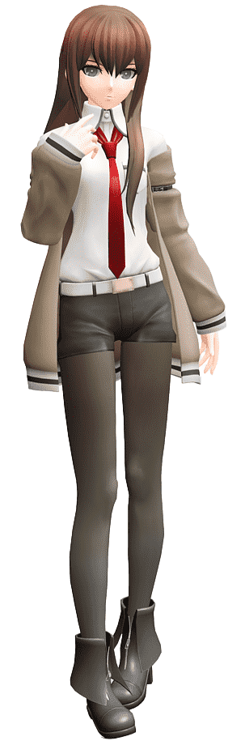

  <!-- ================================
       КВАДРАТНЫЙ КОНТЕЙНЕР ПРОФИЛЯ
       ================================ -->
  

    <!-- Левая часть: вертикальное изображение -->
    

      
    

    <!-- Правая часть: текст, прижатый к изображению -->
    

      

        Михаил Смирнов, я студент IT направления. В моей жизни было много нереализованных проектов, и сейчас я наконец-то за них взялся, и с использованием агента собираюсь их все довести до конца. Моя тактика - создать проект вручную, добавить весь функционал с помощью агента и затем вручную дошлифовать, изменить, переправить - привести проект к готовому виду. Фанат Врат Штейна
      

    

  

---

### Как использовать

1. Загрузите `kurisu.png` в корень своего репозитория (или в папку, например `assets/`).
2. Обновите `src="kurisu.png"` в шаблоне выше на актуальный путь к картинке.
3. Измените `width` / `height` контейнера (сейчас `600px × 600px`) и ширину картинки (`240px`), если нужно подогнать размер под себя.
4. Допишите остальной текст и разделы (навыки, проекты, контакты) ниже или справа, по своему вкусу.
